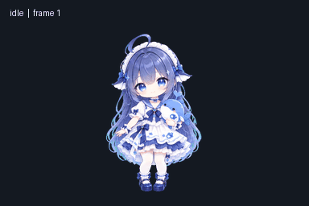
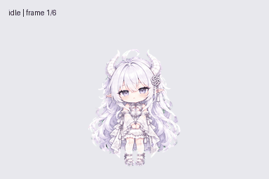
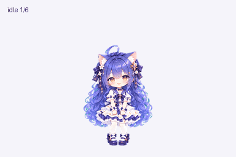
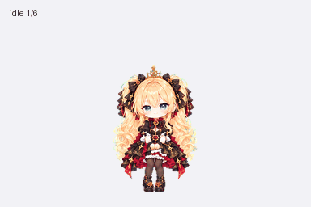
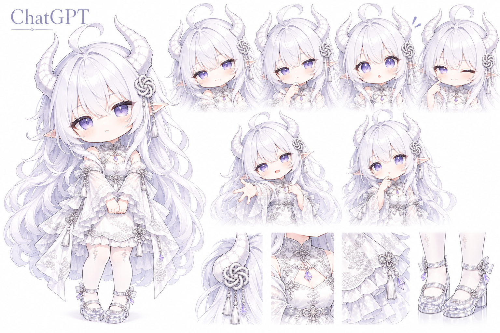
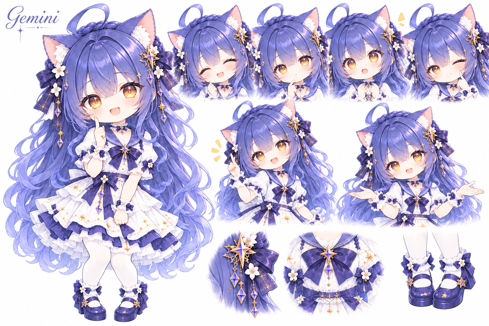
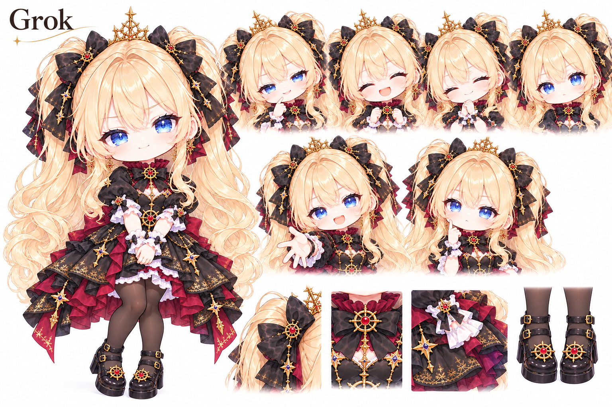

<div align="center">

# Voira Pet

**ChatGPT Work 宠物 · 五位 Q 版角色**

雾蓝的鲸鱼娘、银白的龙裔、温暖的向日葵、好奇的星辰猫耳与狡黠的星冠少女。

[动画预览](#动画预览) · [开始使用](#开始使用) · [认识五位伙伴](#认识五位伙伴) · [角色设定卡](#角色设定卡)

</div>

<p align="center">
  <a href="public/characters/chibi/deepseek/master.png"></a>
  <a href="public/characters/chibi/chatgpt/master.png"></a>
  <a href="public/characters/chibi/claude/master.png"></a>
  <a href="public/characters/chibi/gemini/master.png"></a>
  <a href="public/characters/chibi/grok/master.png"></a>
</p>

Voira Pet 为 ChatGPT Work 制作 Q 版宠物，保存角色立绘、设定卡、动画精灵图与本地安装器。点击角色可查看完整立绘。

> **五位角色均已完成动画并通过 Pets 创建验证。** 当前公开 npm 0.5.0 包含全部五位。

## 动画预览

<p align="center">
  
  
  
  
  
</p>

五位成品均采用 v2 精灵图，包含九种动画状态与十六个注视方向。素材、方向预览和导入说明见 [DeepSeek](public/pets/deepseek/README.md)／[ChatGPT](public/pets/chatgpt/README.md)／[Claude](public/pets/claude/README.md)／[Gemini](public/pets/gemini/README.md)／[Grok](public/pets/grok/README.md)。

## 开始使用

需要 **Node.js 20+**。当前公开 npm 版本为 **0.5.0**，支持五位角色：

```sh
# 领养温柔的 DeepSeek
npx voira-pet install deepseek

# 领养小龙女 ChatGPT
npx voira-pet install chatgpt

# 领养温暖的向日葵 Claude
npx voira-pet install claude

# 领养灵动的星辰猫耳 Gemini
npx voira-pet install gemini

# 领养机灵的星冠双马尾 Grok
npx voira-pet install grok
```

安装后在支持 v2 自定义宠物的桌面客户端「设置 → Pets」中刷新并选择。五者分别写入 `voira-deepseek`、`voira-chatgpt`、`voira-claude`、`voira-gemini` 和 `voira-grok`；默认父目录为 `~/.codex/pets/`，设置过 `CODEX_HOME` 时使用其 `pets/`。不写角色名时仍安装 DeepSeek。

安装器可用 `list` 查看角色，使用 `--dir "/你的/pets目录"` 指定安装位置；相同内容重复安装保持原样，遇到不同的已有内容时停止覆盖。

本地安装不会自动同步网页端 Pets 云收藏，也不会切换活动宠物。网页端需通过支持 v2 的 Pets 创建／导入流程另行添加。

<details>
<summary>下载 ZIP 或从 GitHub 安装固定版本</summary>

[GitHub Release v0.5.0](https://github.com/StephenQiu30/voira-pet/releases/tag/v0.5.0) 提供 DeepSeek、ChatGPT、Claude、Gemini、Grok 的独立 ZIP、安装用 tgz 与 SHA-256 校验和。将 ZIP 解压后的完整文件夹放入上述 `pets/` 目录，保留 `pet.json` 和 `spritesheet.webp`。

也可直接运行 GitHub tgz。npm 12 需要显式允许本次远程下载（[npm 官方说明](https://docs.npmjs.com/cli/v12/commands/npm-install/#allow-remote)）：

```sh
# 领养温柔的 DeepSeek
npx --yes --allow-remote=root https://github.com/StephenQiu30/voira-pet/releases/download/v0.5.0/voira-pet-0.5.0.tgz install deepseek

# 领养小龙女 ChatGPT
npx --yes --allow-remote=root https://github.com/StephenQiu30/voira-pet/releases/download/v0.5.0/voira-pet-0.5.0.tgz install chatgpt

# 领养温暖的向日葵 Claude
npx --yes --allow-remote=root https://github.com/StephenQiu30/voira-pet/releases/download/v0.5.0/voira-pet-0.5.0.tgz install claude

# 领养灵动的星辰猫耳 Gemini
npx --yes --allow-remote=root https://github.com/StephenQiu30/voira-pet/releases/download/v0.5.0/voira-pet-0.5.0.tgz install gemini

# 领养机灵的星冠双马尾 Grok
npx --yes --allow-remote=root https://github.com/StephenQiu30/voira-pet/releases/download/v0.5.0/voira-pet-0.5.0.tgz install grok
```

该参数仅作用于本次命令，不修改全局 npm 配置。

</details>

## 认识五位伙伴

**DeepSeek · 蓝色大肥鱼**<br>
在爱里长大的鲸鱼娘，温柔耐心，轻松里带着一点小机灵。雾蓝长发与弯曲呆毛，清亮蓝瞳，白褶头饰配蓝宝石领结，穿珍珠白与海蓝水手裙，身边贴着一只圆滚的小鲸鱼。

**ChatGPT · 银白龙裔**<br>
安静聪慧的银白龙裔，知性温和，偶尔流露一点小倔强。银白长发、弯卷呆毛、双白龙角与淡紫双瞳，带着尖耳和微鼓的脸颊；佩银色结饰、流苏与紫晶坠，身穿银白绣纹短裙和宽袖，脚踏水晶鞋。

**Claude · 向日葵**<br>
沉稳细腻的向日葵少女，温柔含蓄，笑意温暖。铜橙色长卷发与弯卷呆毛，暖琥珀双瞳，侧边编发缀着向日葵与深棕蝴蝶结；身穿米白花纹短裙、深棕层叠裙摆和泡泡袖，搭配白袜与棕色搭扣鞋。

**Gemini · 星辰猫耳**<br>
灵动好奇的星辰猫耳少女，眼神明亮，喜欢发现日常里的新鲜事。蓝紫色长卷发与环形呆毛，毛绒猫耳、琥珀双瞳，编发间点缀白花、深紫蝴蝶结与金色星饰；身穿白紫层叠短裙，配白袜和紫色搭扣鞋。

**Grok · 星冠双马尾**<br>
机灵活泼的星冠少女，笑里带着一点狡黠与叛逆。金色长卷发扎成双马尾，清亮蓝瞳配精巧金色星冠；黑色蝴蝶结缀着星链与红宝石，身穿黑红层叠裙装和金纹饰边，搭配黑色连裤袜与搭扣厚底鞋。

## 角色设定卡

每张卡展示主立绘、表情、动作与服饰细节。卡内动作不等于独立动画资源。

<details>
<summary>DeepSeek · 蓝白水手裙与鲸鱼伙伴</summary>


</details>

<details>
<summary>ChatGPT · 银白双龙角与水晶鞋</summary>



</details>

<details>
<summary>Claude · 向日葵与温暖浅笑</summary>


</details>

<details>
<summary>Gemini · 星饰与好奇目光</summary>



</details>

<details>
<summary>Grok · 金色双马尾与黑红金裙装</summary>



</details>

角色原图位于 `public/characters/chibi/<角色>/`，包含透明立绘 `master.png` 与白底设定卡 `card.png`；正式宠物位于 `public/pets/<角色>/`。更多说明见[下载与安装](docs/01-下载与安装.md)、[ChatGPT宠物](docs/02-ChatGPT宠物.md)、[Claude宠物](docs/03-Claude宠物.md)、[Gemini宠物](docs/04-Gemini宠物.md)、[Grok宠物](docs/05-Grok宠物.md)和[更新记录](CHANGELOG.md)。

项目由 [Voira](https://github.com/StephenQiu30/voira) 的 Q 版形象延展，独立维护。角色名称不代表接入同名模型服务，也不代表模型厂商的官方形象或合作关系。欢迎通过 [Issues](https://github.com/StephenQiu30/voira-pet/issues) 分享建议。
